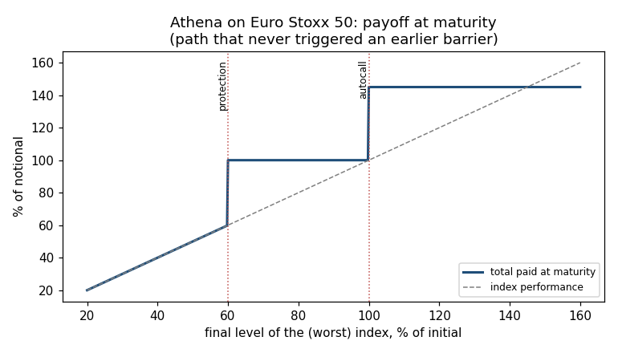
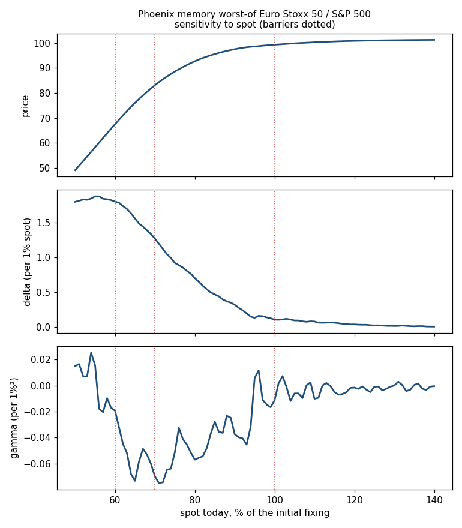
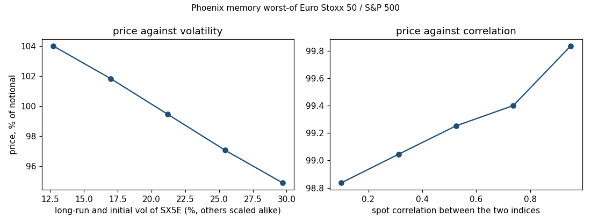
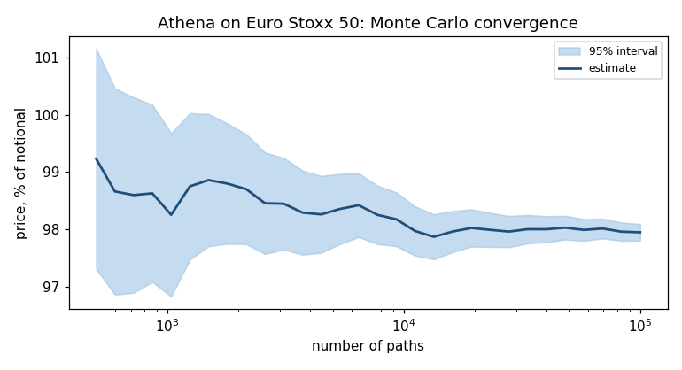
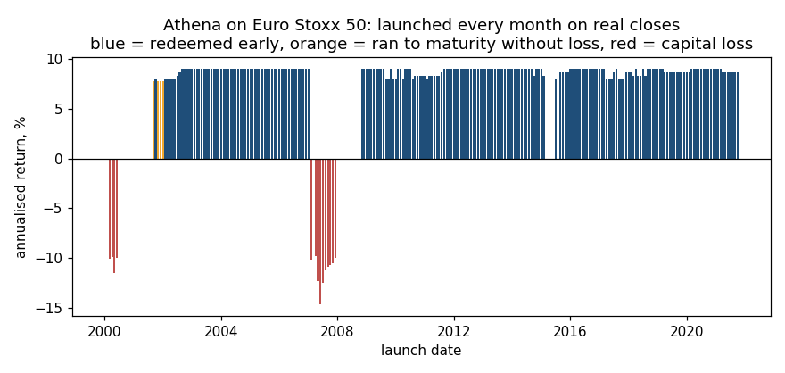
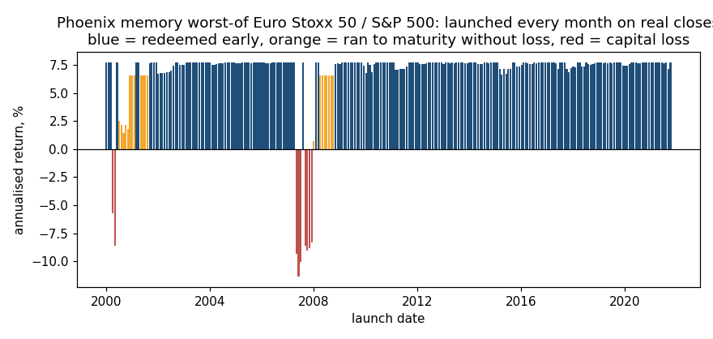

# structured-notes

A pricer for autocallable structured notes on the Euro Stoxx 50 and the S&P 500, under the Heston stochastic volatility model.

It reads a note the way its term sheet is written (observation dates, autocall barrier, coupon barrier, capital barrier),
simulates the indices with Heston, and returns what a structuring desk looks at before selling it:
the price with its Monte Carlo error, the coupon that makes the note worth par, the chance of early redemption and of a capital loss,
the expected life, and the Greeks. A backtest then launches the same note on every past month start in the real index history.

Products: Athena autocall, Phoenix autocall with memory coupon, barrier reverse convertible, each on one index or on the worst of two;
plain European call and put to validate the engine.

## Run it

```bash
pip install -r requirements.txt
python fetch_history.py      # optional: data/ already holds the daily closes; this refreshes them from Yahoo
python run.py                # offline: prices, figures and Markdown into output/
python -m pytest -q          # 25 tests, a few seconds
```

## Layout

| file | what it does |
|---|---|
| `notes/params.py` | every model input, each labelled as an assumption |
| `notes/products.py` | term sheets as dataclasses and their payoffs |
| `notes/heston.py` | closed-form Heston price ("little trap" form) and the Monte Carlo path generator |
| `notes/pricing.py` | price and standard error, fair coupon, probabilities, Greeks |
| `notes/backtest.py` | the note launched every month on real closes |
| `run.py` | the three reference notes, figures, `output/results.md` |

## Results of the three reference notes

From `output/results.md` (100,000 paths, weekly grid, seed 2026). Prices in % of notional at the stated coupon;
the fair coupon is the one that makes the price exactly 100%.

| note | stated coupon | price (std error) | 95% interval | fair coupon a year | P(early redemption) | P(capital loss) | expected life |
|---|---|---|---|---|---|---|---|
| Athena on Euro Stoxx 50, 5y annual, autocall 100%, protection 60% | 9.00% | 97.95 (0.07) | [97.80, 98.09] | 10.97% | 71.4% | 12.5% | 2.41y |
| Phoenix memory on S&P 500, 5y quarterly, autocall 100%, coupon 70%, capital 60% | 6.50% | 99.53 (0.04) | [99.45, 99.60] | 7.13% | 91.4% | 3.7% | 0.96y |
| Phoenix memory worst-of Euro Stoxx 50 / S&P 500, same barriers, EUR | 7.50% | 99.31 (0.06) | [99.19, 99.44] | 8.11% | 79.3% | 11.0% | 1.59y |

Greeks (bump and reprice on common random numbers, in % of notional): Athena delta +0.401 per 1% of spot, vega −0.572 per vol point;
Phoenix S&P 500 delta +0.068, vega −0.247; worst-of delta +0.106, vega −0.563, correlation +0.184 per +0.10 of correlation.
All three notes lose value when volatility rises (the investor is short a put) and the worst-of gains when correlation rises.

Engine check: a 1-year at-the-money call on the Euro Stoxx 50 is 6.6964 in closed form and 6.7306 by Monte Carlo
(standard error 0.0224, 95% interval [6.6868, 6.7744]), so the closed form sits inside the interval.

## Historical backtest

No model here: the same note is launched on the first trading day of every month from January 2000 to October 2021
(262 launches, each with a full five years of history after it) and followed on the realised daily closes.

| note | redeemed early | ended with a capital loss | average annualised return | worst annualised return | worst launch month |
|---|---|---|---|---|---|
| Athena on Euro Stoxx 50 | 80.9% | 5.3% | +6.65% | −14.61% | June 2007 |
| Phoenix memory on S&P 500 | 93.9% | 0.0% | +6.55% | +5.79% | April 2000 |
| Phoenix memory worst-of | 88.9% | 3.4% | +6.84% | −11.34% | June 2007 |

The losses all come from notes launched in 2000 or in 2007, just before the two large falls of the period. The model
gives higher loss probabilities (12.5%, 3.7%, 11.0%) than this history (5.3%, 0.0%, 3.4%): the two are different questions,
a risk-neutral price against one realised path of 27 years, and overlapping monthly launches are far from independent.

The history also checks the model inputs: realised volatility is 22.0% on the Euro Stoxx 50 and 19.2% on the S&P 500
(inputs 21.2% and 19.2%), and the weekly return correlation is 0.78 (input 0.75).

Data: daily closes from 3 January 2000. S&P 500 to 11 November 2026 and Euro Stoxx 50 from April 2007 to 6 October 2026
from Investing.com exports; Euro Stoxx 50 before April 2007 from the index provider's own file (stoxx.com). Over the
2,432 days where the two Euro Stoxx 50 sources overlap, the median difference is zero and the largest is 0.38%.
`import_history.py` builds `data/` from those files; `fetch_history.py` does the same from Yahoo when it answers.

## Figures

Payoff at maturity on a path that never triggered an earlier barrier: the drop at the protection barrier is the short put.



Price, delta and gamma against today's spot, barriers fixed at the initial fixing:



Price against volatility and against correlation for the worst-of:



Monte Carlo convergence:





Per-note one-page term sheets: [Athena](output/athena_sx5e.md), [Phoenix S&P 500](output/phoenix_spx.md), [Phoenix worst-of](output/phoenix_worstof.md).
`NOTES.md` explains the finance behind every number.

## Limits

- **Illustrative parameters, no calibration.** The Heston parameters, rates and dividend yields in `notes/params.py` are stated assumptions,
  not fitted to option prices. Calibrating them to a real implied volatility surface (the sibling project `vol-surface` builds one) is the natural next step.
- **Flat rates and a continuous dividend yield.** No yield curve, no discrete dividends, no repo.
- **No quanto adjustment.** The worst-of is paid in EUR but the S&P 500 drifts at the USD rate with no correction for the FX-equity correlation.
- **Euler discretisation bias.** Full-truncation Euler on a weekly grid is biased; the error is small next to the Monte Carlo error for the European check, but it is not zero.
- **Barrier monitoring.** Autocall and coupon barriers are observed on their dates; the barrier reverse convertible is monitored weekly in the model and daily in the backtest. A continuously monitored barrier would be hit more often.
- **No issuer credit risk or funding.** A real issuer discounts at its own funding spread, which is where much of a note's coupon comes from; this pricer discounts at the risk-free rate, so its fair coupons are lower than market ones for the same terms.
- **Bump Greeks are noisy near barriers.** The payoffs are discontinuous; finite differences there depend on the bump size (the gamma panels show the noise).
- **Run time.** The full `run.py` took 200 seconds on this machine while other jobs were running, above the two-minute target; lowering `N_PATHS` in `params.py` or `CURVE_PATHS` in `run.py` shortens it.
