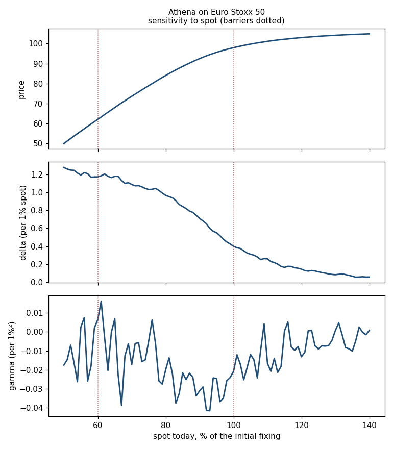

# Athena on Euro Stoxx 50

## Terms
- Underlying: SX5E
- Currency: EUR, maturity 5 years, annual observations
- Coupon: 9.00% per period (9.00% a year)
- Autocall barrier: 100% of initial level
- Coupons accumulate and are paid on early redemption or at maturity above the autocall barrier
- Capital protection barrier at maturity: 60%
- Below the capital barrier at maturity the investor gets the (worst) index performance

## Model value (Heston Monte Carlo, illustrative parameters)
- Price: **97.95%** of notional, standard error 0.07, 95% interval [97.80, 98.09], 100,000 paths
- Fair coupon (price = 100%): **10.972% per period** (10.97% a year)
- Probability of early redemption: 71.4%
- Probability of a capital loss at maturity: 12.5%
- Expected life: 2.41 years

| date (years) | 1 | 2 | 3 | 4 | 5 |
|---|---|---|---|---|---|
| redeemed here | 54.2% | 10.1% | 4.5% | 2.7% | 28.6% |

## Greeks (bump and reprice, common random numbers, in % of notional)
- Delta, +1% spot: +0.401
- Gamma, change of delta for +1% spot: -0.0242
- Vega, +1 vol point on initial and long-run vol: -0.572

## Backtest on real closes
- Not run: no index history in data/. Run `python fetch_history.py`, then `python run.py` again.

