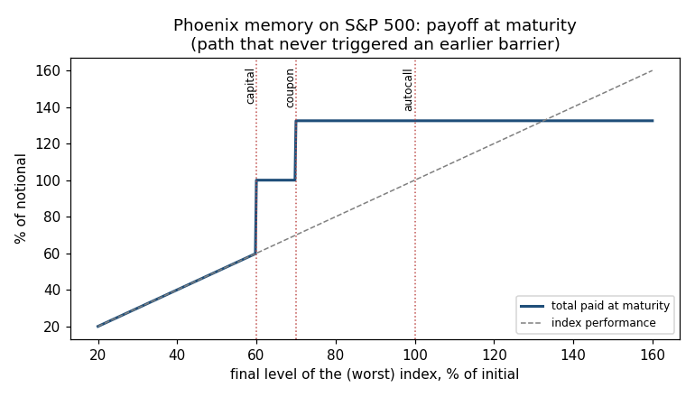
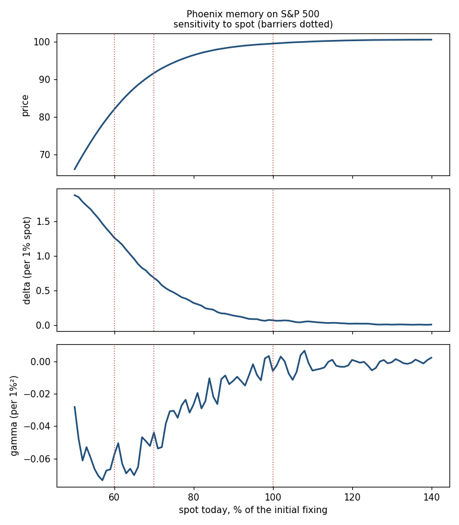
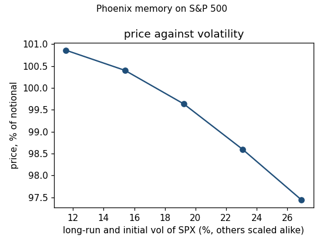
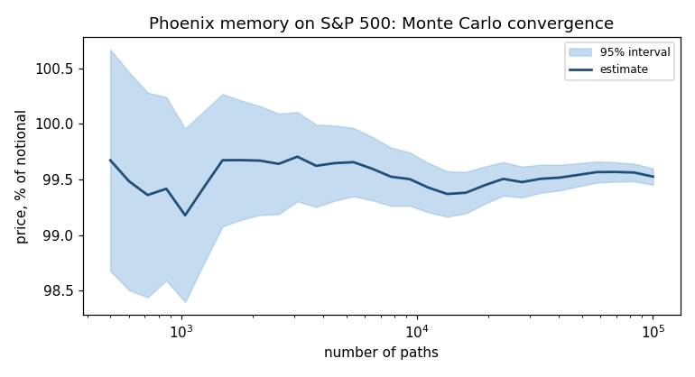

# Phoenix memory on S&P 500

## Terms
- Underlying: SPX
- Currency: USD, maturity 5 years, quarterly observations
- Coupon: 1.62% per period (6.50% a year)
- Autocall barrier: 100% of initial level
- Coupon barrier: 70%, with memory of missed coupons
- Capital barrier at maturity: 60%
- Below the capital barrier at maturity the investor gets the (worst) index performance

## Model value (Heston Monte Carlo, illustrative parameters)
- Price: **99.53%** of notional, standard error 0.04, 95% interval [99.45, 99.60], 100,000 paths
- Fair coupon (price = 100%): **1.781% per period** (7.13% a year)
- Probability of early redemption: 91.4%
- Probability of a capital loss at maturity: 3.7%
- Expected life: 0.96 years

| date (years) | 0.25 | 0.5 | 0.75 | 1 | 1.25 | 1.5 | 1.75 | 2 | 2.25 | 2.5 | 2.75 | 3 | 3.25 | 3.5 | 3.75 | 4 | 4.25 | 4.5 | 4.75 | 5 |
|---|---|---|---|---|---|---|---|---|---|---|---|---|---|---|---|---|---|---|---|---|
| redeemed here | 61.2% | 11.4% | 5.1% | 3.0% | 2.0% | 1.5% | 1.2% | 0.9% | 0.8% | 0.7% | 0.6% | 0.5% | 0.4% | 0.4% | 0.4% | 0.3% | 0.3% | 0.3% | 0.2% | 8.6% |

## Greeks (bump and reprice, common random numbers, in % of notional)
- Delta, +1% spot: +0.068
- Gamma, change of delta for +1% spot: -0.0163
- Vega, +1 vol point on initial and long-run vol: -0.247

## Backtest on real closes
- Not run: no index history in data/. Run `python fetch_history.py`, then `python run.py` again.

