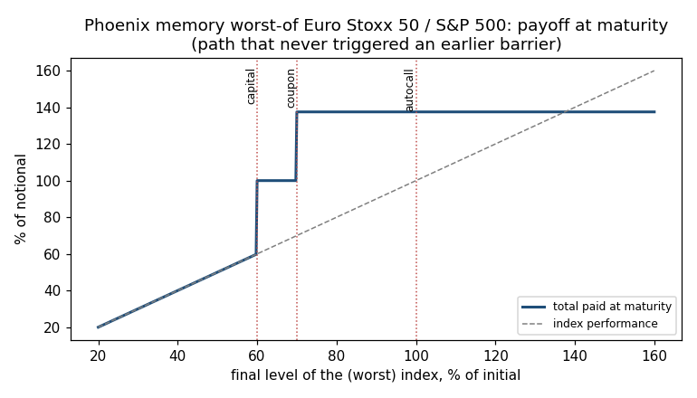
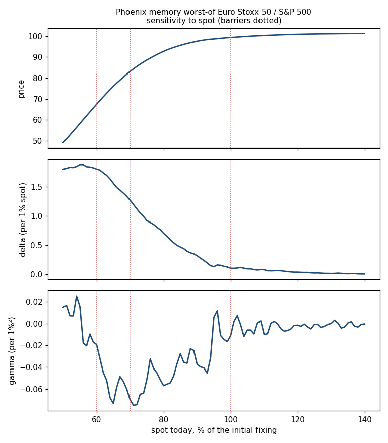
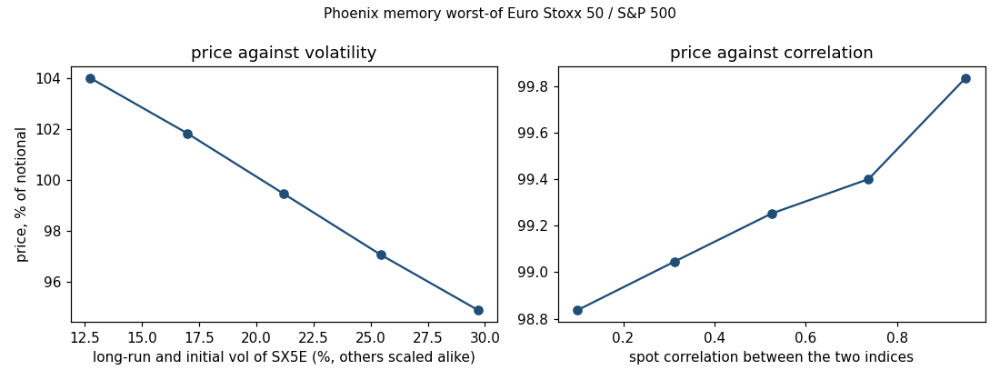
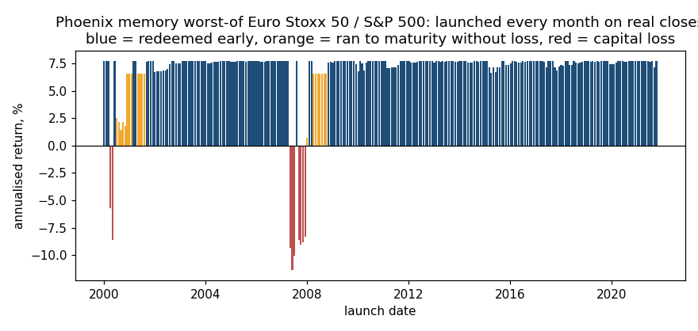

# Phoenix memory worst-of Euro Stoxx 50 / S&P 500

## Terms
- Underlying: SX5E and SPX (worst-of)
- Currency: EUR, maturity 5 years, quarterly observations
- Coupon: 1.88% per period (7.50% a year)
- Autocall barrier: 100% of initial level
- Coupon barrier: 70%, with memory of missed coupons
- Capital barrier at maturity: 60%
- Below the capital barrier at maturity the investor gets the (worst) index performance

## Model value (Heston Monte Carlo, illustrative parameters)
- Price: **99.31%** of notional, standard error 0.06, 95% interval [99.19, 99.44], 100,000 paths
- Fair coupon (price = 100%): **2.028% per period** (8.11% a year)
- Probability of early redemption: 79.3%
- Probability of a capital loss at maturity: 11.0%
- Expected life: 1.59 years

| date (years) | 0.25 | 0.5 | 0.75 | 1 | 1.25 | 1.5 | 1.75 | 2 | 2.25 | 2.5 | 2.75 | 3 | 3.25 | 3.5 | 3.75 | 4 | 4.25 | 4.5 | 4.75 | 5 |
|---|---|---|---|---|---|---|---|---|---|---|---|---|---|---|---|---|---|---|---|---|
| redeemed here | 45.9% | 11.5% | 5.6% | 3.4% | 2.3% | 1.9% | 1.4% | 1.1% | 1.0% | 0.8% | 0.7% | 0.7% | 0.6% | 0.5% | 0.5% | 0.4% | 0.4% | 0.4% | 0.3% | 20.7% |

## Greeks (bump and reprice, common random numbers, in % of notional)
- Delta, +1% spot: +0.106
- Gamma, change of delta for +1% spot: -0.0071
- Vega, +1 vol point on initial and long-run vol: -0.563
- Correlation, +0.10 on spot correlation: +0.184

## Backtest on real closes
- 262 monthly launches from 2000-01-03 to 2021-10-01
- Redeemed early: 88.9%; ended with a capital loss: 3.4%
- Where they ended: 0.25y 55%, 0.5y 11%, 0.75y 6%, 1y 3%, 1.25y 2%, 1.5y 2%, 1.75y 0%, 2y 0%, 2.25y 2%, 2.5y 2%, 2.75y 1%, 3y 0%, 3.5y 1%, 3.75y 1%, 4y 2%, 4.25y 0%, 4.5y 0%, 4.75y 0%, 5y 11%
- Annualised return: average +6.84%, worst -11.34%
- Worst launch dates: 2007-06-01 (-11.3%), 2007-07-02 (-10.1%), 2007-05-02 (-9.3%), 2007-10-01 (-9.0%), 2007-11-01 (-8.8%)

