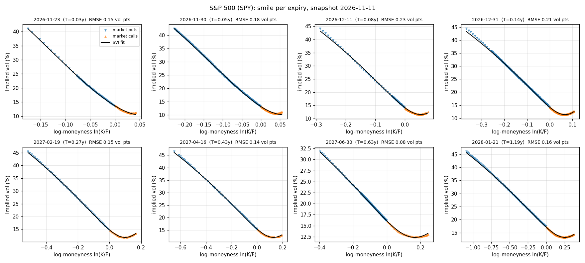
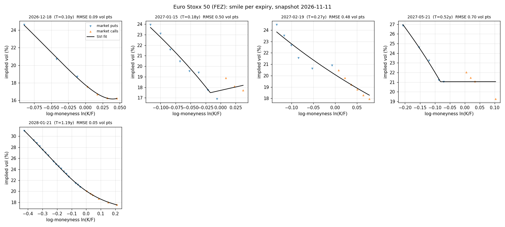
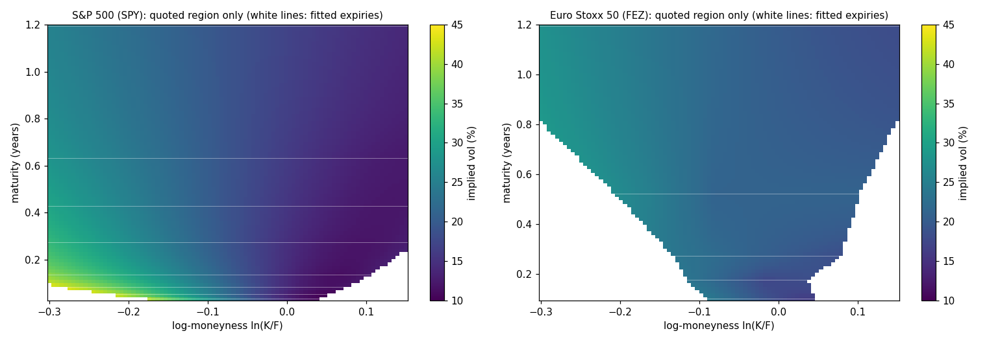
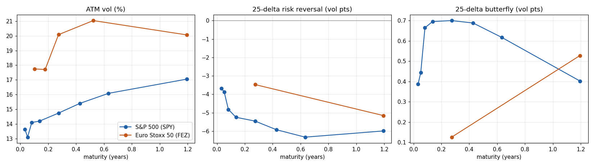
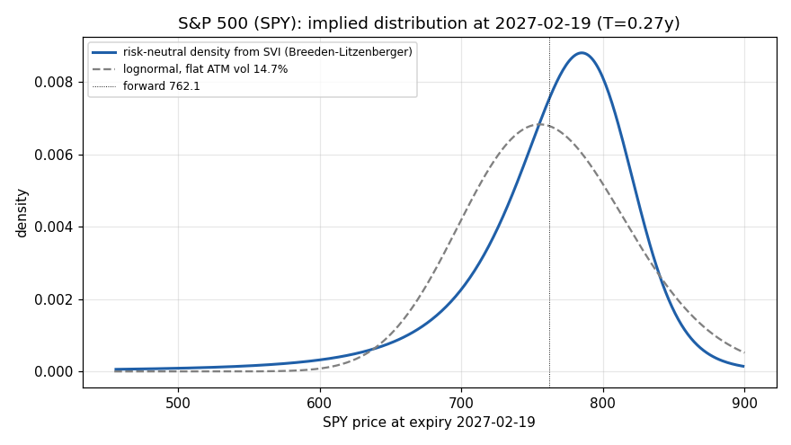
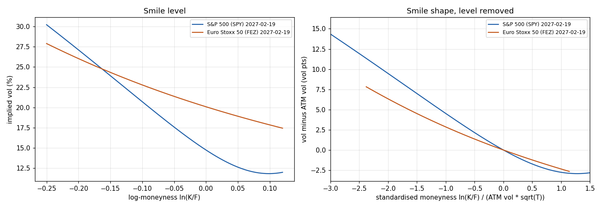

# vol-surface: implied volatility surfaces from listed index options

This project takes one snapshot of real listed option quotes on the S&P 500
(through the SPY ETF) and the Euro Stoxx 50 (through the FEZ ETF) and turns them
into an implied volatility surface for each, the way a derivatives desk does:

1. back out each expiry's forward and discount factor from put-call parity,
2. drop quotes that are not real prices (named filters, each one counted),
3. solve the Black-76 implied vol of every out-of-the-money option,
4. fit an SVI smile to each expiry, weighted by vega,
5. check the fitted surface for butterfly and calendar arbitrage and report what it finds,
6. read off what a desk quotes: at-the-money vol, 25-delta risk reversal and
   butterfly per expiry, and the risk-neutral density of one expiry.

Snapshot: close of **11 November 2026**. SPY spot 755.80, FEZ spot 67.50.
8 expiries each, from 12 days to 14 months. The maths is in [NOTES.md](NOTES.md).

## Run it

```bash
pip install -r requirements.txt
python fetch_chain.py      # once, needs network: writes data/*.csv (already included)
python run.py              # offline: writes output/*.png and output/results.md
python -m pytest -q        # 234 tests, no network
```

`fetch_chain.py` asks Yahoo Finance (yfinance) first. On the day of the snapshot
Yahoo rate-limited every request, so the saved chains come from the fallback
source, Cboe's public delayed quotes for the same listed contracts (bid, ask,
volume, open interest; the `source` column of each CSV says which). Nothing in
`data/` is simulated.

## Results

All figures and numbers come from `python run.py` on the saved snapshot; the
full tables, including SVI parameters, are in [output/results.md](output/results.md).

### Smiles: market against SVI




### Surface, term structure, density, US against Europe






### Fit quality

RMSE between market and SVI implied vols, in vol points, unweighted.

| Underlying | Expiry | T (y) | Quotes | RMSE | Max err | ATM vol | RR 25d | BF 25d |
|---|---|---:|---:|---:|---:|---:|---:|---:|
| SPY | 2026-11-23 | 0.033 | 102 | 0.15 | 0.74 | 13.63 | -3.68 | +0.39 |
| SPY | 2026-11-30 | 0.052 | 198 | 0.18 | 1.03 | 13.09 | -3.87 | +0.44 |
| SPY | 2026-12-11 | 0.082 | 123 | 0.23 | 0.98 | 14.10 | -4.82 | +0.66 |
| SPY | 2026-12-31 | 0.137 | 272 | 0.21 | 1.14 | 14.18 | -5.25 | +0.69 |
| SPY | 2027-02-19 | 0.274 | 90 | 0.15 | 0.53 | 14.73 | -5.45 | +0.70 |
| SPY | 2027-04-16 | 0.427 | 91 | 0.14 | 0.50 | 15.40 | -5.92 | +0.69 |
| SPY | 2027-06-30 | 0.633 | 181 | 0.08 | 0.26 | 16.08 | -6.32 | +0.62 |
| SPY | 2028-01-21 | 1.195 | 177 | 0.16 | 0.57 | 17.05 | -5.99 | +0.40 |
| FEZ | 2026-12-18 | 0.101 | 7 | 0.09 | 0.16 | 17.75 | n/a | n/a |
| FEZ | 2027-01-15 | 0.178 | 11 | 0.50 | 1.08 | 17.71 | (-1.55) | (+1.48) |
| FEZ | 2027-02-19 | 0.274 | 12 | 0.48 | 0.83 | 20.08 | -3.47 | +0.13 |
| FEZ | 2027-05-21 | 0.523 | 9 | 0.70 | 1.79 | 21.04 | (-0.64) | (+0.32) |
| FEZ | 2028-01-21 | 1.195 | 23 | 0.05 | 0.10 | 20.07 | -5.15 | +0.53 |

Values in brackets need a 25-delta strike outside the quoted strikes, so they are
SVI extrapolation, not market data; they are left off the term-structure chart.

- **SPY**: 1,234 of 3,232 quotes kept, 8 of 8 expiries fitted, mean RMSE **0.16 vol points**.
- **FEZ**: 62 of 522 quotes kept, 5 of 8 expiries fitted (three weekly expiries
  had no quote with open interest), mean RMSE **0.37 vol points**.
- **Arbitrage**: no butterfly violation (Gatheral's g(k) stays positive across
  every slice's quoted range) and no calendar violation (total variance rises with
  maturity on the common quoted range of every adjacent pair), on either surface.
- **What the numbers say**: SPY's at-the-money vol rises from about 13% at two
  weeks to 17% at fourteen months, and its skew is steep, with the 25-delta risk
  reversal going from -3.7 to about -6 vol points. The SPY risk-neutral density
  at February 2027 has a much fatter left tail and a higher peak above the
  forward than the lognormal with the same ATM vol. FEZ trades at a higher vol
  level (about 18% to 21%) with a flatter skew in standardised moneyness, but its
  chain is thin, so treat its shape as indicative.

## Limits

- **American options treated as European.** SPY and FEZ options are American.
  The engine prices them with Black-76 and uses only out-of-the-money options,
  where early exercise is rarely worth anything, so the error is small. It is
  not zero: in the put-call parity regression the discount factor of SPY comes
  out slightly above 1 at short maturities (1.0101 at two weeks, 1.0220 at one
  month), which is the early-exercise premium of in-the-money puts tilting the
  line. Those discount factors are reported as measured, not corrected.
- **ETF proxies for the indices.** SPY and FEZ are ETFs, not the S&P 500 and
  Euro Stoxx 50 indices; the desk instruments would be SPX options and SX5E
  options on Eurex. FEZ in particular is a thin US-listed product: few strikes,
  wide spreads, little open interest.
- **FEZ borrows SPY's discount factors.** FEZ's parity regression has about six
  wide quotes per expiry, too few to pin down its slope (it gave discount factors
  from 0.85 to 1.13). Both ETFs are dollar-listed, so FEZ uses SPY's discount
  factor at the same maturity and solves only its forward from its own parity.
- **Few FEZ points per slice.** With 7 to 23 quotes for 5 parameters, some FEZ
  SVI fits sit on parameter bounds (see `output/results.md`); a low RMSE there
  means a flexible curve through few points, not a well-identified smile.
- **One snapshot in time.** One close, delayed quotes. Nothing here says how
  stable the fits or the arbitrage checks are from day to day.
- **Dividends through the implied forward.** No dividend data is used; the
  forward from parity carries them. Calendar days / 365 for maturities, from the
  snapshot close.
- **Arbitrage checked on quoted ranges only.** The checks run where there are
  quotes; SVI extrapolated far beyond them is not guaranteed to be arbitrage-free.

## Layout

```
fetch_chain.py        download and save the snapshot (data/)
run.py                build both surfaces, write output/
volsurf/black.py      Black-76 prices and Greeks
volsurf/implied.py    implied vol solver: bounds, Newton, Brent fallback
volsurf/forward.py    forward and discount factor from put-call parity
volsurf/clean.py      named quote filters
volsurf/svi.py        raw SVI fit, butterfly and calendar checks
volsurf/surface.py    surface interpolation, risk-neutral density, ATM / RR / BF
tests/                pytest suite, synthetic data only
```
